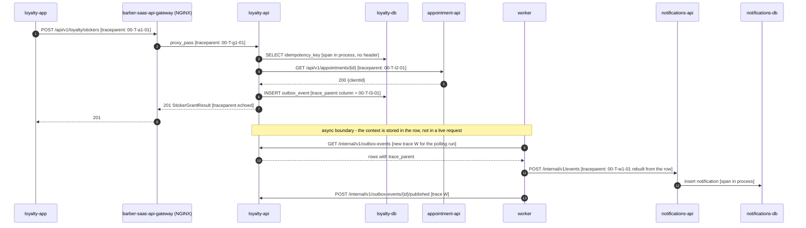

# CP1 - Critical Journey: a Barber Grants a Loyalty Sticker

**User story:** HU-LOY-001, scenario 1 "Sticker granted" (FR-013, `INV-LOYAL-002`).
**Trigger:** a `BARBER` taps the grant action for a client after a visit; the request names the
visit's `appointmentId` so the sticker is audited against it (`DEC-LOY-01`).
**Outcome:** `loyalty_card.stickers_count` grows by 1, a `STICKER_EARNED` row lands in
`loyalty_transaction`, and the client later receives the "Ganaste un sello" notification.

## Hops

| Step | Caller | Callee | Protocol | Operation | Sync/Async | Data |
|---|---|---|---|---|---|---|
| 1 | loyalty-app (shell HTTP client) | barber-saas-api-gateway | HTTPS | `POST /api/v1/loyalty/stickers` | Sync | Bearer token, `Idempotency-Key`, body `{clientId, appointmentId}` |
| 2 | barber-saas-api-gateway | loyalty-api | HTTP | `proxy_pass` from `routes/loyalty.conf` (`location /api/v1/loyalty/`) | Sync | Same request; the edge rejects a missing token with `401` |
| 3 | loyalty-api | loyalty-db | JDBC | Idempotency lookup in `loyalty.idempotency_key` | Sync | Tenant, key, request hash |
| 4 | loyalty-api | appointment-api | HTTP | `GET /api/v1/appointments/{id}` (`getAppointmentById`) | Sync | Caller's token; answer `clientId` or `404` |
| 5 | appointment-api | appointment-db | JDBC | Read `appointment.appointment` scoped by the token's tenant | Sync | Appointment row |
| 6 | loyalty-api | loyalty-db | JDBC | One transaction: `loyalty_card`, `loyalty_transaction`, `idempotency_key`, `outbox_event` (`StickerGranted`); reads `loyalty_rewards_config` | Sync | Card, transaction, event payload |
| 7 | barber-saas-worker | loyalty-api | HTTP | `GET /internal/v1/outbox-events?limit=50` | Async (polled every 5 s) | Pending `StickerGranted` rows |
| 8 | barber-saas-worker | notifications-api | HTTP | `POST /internal/v1/events` | Async | ADR-016 envelope `{id, type, version, occurredAt, aggregateType, aggregateId, barbershopId, correlationId, payload}` |
| 9 | notifications-api | notifications-db | MongoDB | Insert into `notification` (unique `sourceEventId`) | Async | `SYSTEM` notice for `clientId` |
| 10 | barber-saas-worker | loyalty-api | HTTP | `POST /internal/v1/outbox-events/{id}/published` | Async | Sets `published_at` |

Steps 1-6 run while the barber waits; the request returns `201` with `StickerGrantResult` once
step 6 commits. Steps 7-10 happen seconds later, in a different process, with no open request.

## Trace propagation

`T` is the journey's `trace_id`; `a1`, `g1`, `l2`, `l3`, `w1` are parent span ids. ADR-016 uses no
broker, so the "message header" is the outbox row: a `trace_parent` field written
next to `correlation_id` in `loyalty.outbox_event` and carried in the envelope. The polling run
itself (steps 7 and 10) is its own trace `W`, because one run serves events from many requests.

## Span tree

- `POST /api/v1/loyalty/stickers` - gateway, SERVER, root of trace `T`
  - `POST /api/v1/loyalty/stickers` - loyalty-api, SERVER
    - `loyalty.idempotency.lookup` - loyalty-api, INTERNAL (db)
    - `GET /api/v1/appointments/{id}` - loyalty-api, CLIENT
      - `GET /api/v1/appointments/{id}` - appointment-api, SERVER
        - `appointment.select` - appointment-api, INTERNAL (db)
    - `loyalty.sticker.save` - loyalty-api, INTERNAL (db transaction, writes `outbox_event`)
      - `deliver StickerGranted` - worker, CONSUMER, same `trace_id` `T`, parent `l3`
        - `POST /internal/v1/events` - notifications-api, SERVER
          - `notification.insert` - notifications-api, INTERNAL (db)

The span `deliver StickerGranted` is the one that crosses the asynchronous boundary: it starts
seconds after the root has ended, in `barber-saas-worker`, yet keeps `trace_id` `T` because its
parent is read from the outbox row. It also carries a span link to the polling run `W`.
