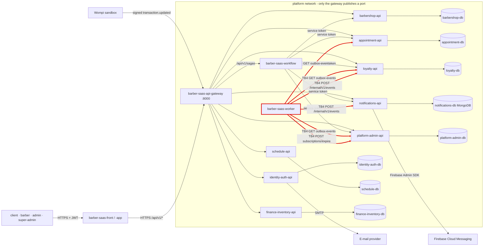
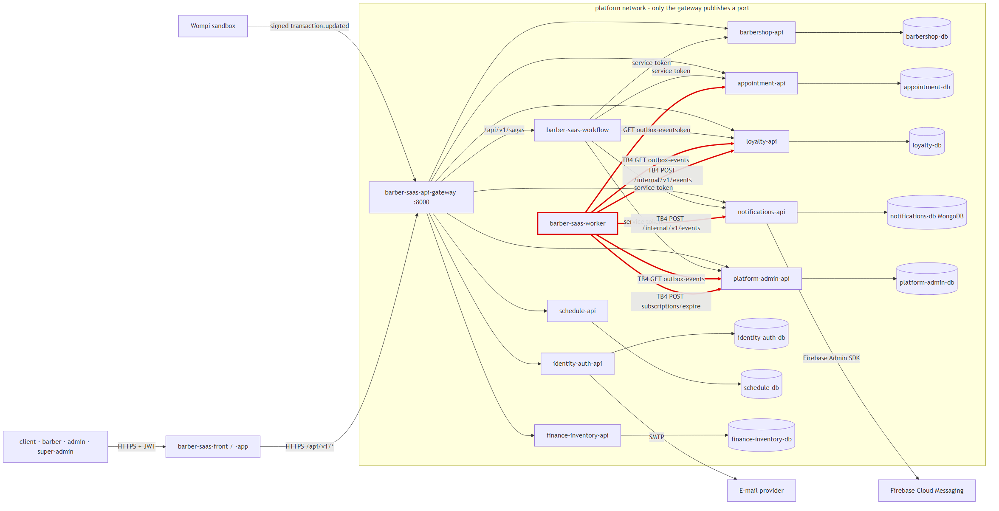

# CP1 - Attack surface map

Sources: `05-architecture/overview.md` (container diagram), `05-architecture/deployment.md` §6,
ADR-016 (worker relay), ADR-017 (Wompi), `06-data/models.md` §10 (`outbox_event`).

## Data flow and trust boundaries

My boundary is **TB4** (red): `barber-saas-worker` calling the `/internal/v1` operations of the
domain services.

The same diagram as an image:

| Id | Boundary | Crosses from → to |
|---|---|---|
| TB1 | Internet → gateway | Apps and Wompi → `barber-saas-api-gateway` |
| TB2 | Gateway → domain services | Gateway → the 8 `-api` services and `barber-saas-workflow` |
| TB3 | Workflow → domain services | Saga steps with the workflow service token |
| **TB4** | **Worker → `/internal/v1` (mine)** | **`barber-saas-worker` → appointment, loyalty, notifications, platform-admin** |
| TB5 | Service → its database | Each `-api` → its own schema as `<domain>_app` |
| TB6 | notifications-api → FCM | Push messages leave the platform |
| TB7 | identity-auth-api → SMTP | Verification and recovery e-mails leave the platform |
| TB8 | Wompi → platform-admin-api | `POST /api/v1/payments/wompi/events`, public route |

## Asset inventory (my domain side)

| Asset | Where it lives | Classification |
|---|---|---|
| `WORKER_SERVICE_TOKEN` (JWT, `sub: barber-saas-worker`) | worker container as `SERVICE_TOKEN`; issued by identity-auth | Restricted |
| Event envelope `{id, type, barbershopId, aggregateId, correlationId, payload}` | `outbox_event` in appointment-db, loyalty-db, platform-admin-db; in transit on TB4 | Confidential |
| Loyalty sticker card and rewards of a client | loyalty-db, changed by `AppointmentCompleted` | Confidential |
| `device_token` (FCM token) and `notification` records | notifications-db | Confidential |
| Subscription status of a barbershop (`ACTIVE`, suspended) | platform-admin-db, changed by `subscriptions/expire` | Internal |
| `correlationId` / `X-Correlation-Id` | every request and log line on TB4 | Internal |

## Entry points of TB4

| Service | Entry point | Called by | Authentication today |
|---|---|---|---|
| appointment-api | `GET /internal/v1/outbox-events?limit=`, `POST …/{id}/published`, `POST …/{id}/failed` | worker, every 5 s | Bearer RS256 service JWT, only `sub: barber-saas-worker` |
| loyalty-api | same outbox operations + `POST /internal/v1/events` | worker | Same; `Caller.requireService("barber-saas-worker")` in `HandleEvents` and `RelayOutbox` |
| notifications-api | `POST /internal/v1/events` | worker | Same service JWT (Python service) |
| platform-admin-api | outbox operations, `POST /internal/v1/subscriptions/expire`, `POST /internal/v1/subscriptions/notices`, `POST /internal/v1/trials/expire` | worker, daily | Same service JWT |

Port: every service listens on `8080` with `expose` only; the gateway never routes `/internal/v1`.
There is no mTLS: inside the `platform` network the only control is the token.
