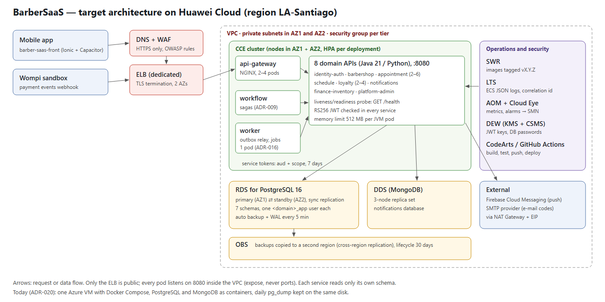

# Architecture design note — BarberSaaS

## 1. Target architecture

BarberSaaS is a multi-tenant SaaS for barbershops: clients book appointments, barbers work their schedule, owners
run the business and a platform admin sells the plans. Today the whole platform runs on one Azure for Students VM
with Docker Compose (ADR-020). The diagram is where I would take it on Huawei Cloud, applying the course chapters to
the services our team already built. The services, their boundaries and their contracts do not change; what
changes is where they run, how the data survives a failure and how a release reaches production.

| Component in the diagram | Defined in (file of your team's -docs) |
|---|---|
| Mobile app `barber-saas-front` | 05-architecture/decisions/records/ADR-013-hybrid-mobile-interface.md |
| `api-gateway` (NGINX, single entry) | 05-architecture/overview.md (§4.2) |
| Eight domain APIs (identity-auth, barbershop, appointment, schedule, loyalty, notifications, finance-inventory, platform-admin) | 05-architecture/overview.md (§4.1), 09-microservices/service-catalog.md |
| `workflow` (sagas) | 05-architecture/decisions/records/ADR-009-saga-state-store.md |
| `worker` (outbox relay and daily jobs) | 05-architecture/decisions/records/ADR-016-event-transport-worker-relay.md |
| PostgreSQL, one instance with seven schemas | 05-architecture/decisions/records/ADR-011-single-instance-per-engine.md, ADR-006-database-engine-per-domain.md |
| MongoDB for notifications | 05-architecture/decisions/records/ADR-006-database-engine-per-domain.md |
| Service tokens with `aud` and `scope` | 07-api/authentication.md |
| Current host (one VM) and its backups | 05-architecture/decisions/records/ADR-020-hosting-azure-for-students.md |
| Logs, metrics and traces | 13-operations/observability.md, 05-architecture/deployment.md (§7) |
| Firebase Cloud Messaging and SMTP | 05-architecture/overview.md (§2) |

## 2. Five principles

| Principle | Current weakness | Evidence in -docs | Design decision | Huawei Cloud service |
|---|---|---|---|---|
| Reliability | One VM is a single point of failure: if it stops, every service, both databases and the worker stop together, and most containers have no restart policy | 05-architecture/decisions/records/ADR-020-hosting-azure-for-students.md (Accepted cost) | Spread the pods over two AZs with liveness and readiness probes on `GET /health`, and move PostgreSQL to a managed primary/standby pair (ADR-C3-01) | CCE, ELB, RDS for PostgreSQL (primary/standby) |
| Security | The worker calls the `/internal/v1` routes over plain HTTP, and the JWT private key and DB passwords live in a `.env` file on the VM disk | 05-architecture/security/stride-JUANDAX233.md (rows S and I) | Keep the 7-day service tokens with `aud` and `scope`, add a WAF in front of the ELB, keep secrets in a managed vault, and separate the tiers with security groups | WAF, DEW (KMS + CSMS), security groups |
| Performance efficiency | The B-series VM gives CPU in bursts and can be throttled under sustained load; the latency targets were never measured | 05-architecture/decisions/records/ADR-020-hosting-azure-for-students.md, 04-requirements/non-functional.md (NFR-001) | Run on general-purpose nodes, scale each hot service horizontally on CPU, and measure P95 against the 300 ms target with a load test before going live | CCE (HPA), ELB, AOM |
| Cost | The platform lives on a USD 100 student credit (about USD 86 a month if left on) and has no host once it runs out | 05-architecture/decisions/records/ADR-020-hosting-azure-for-students.md (Accepted cost) | Yearly/monthly nodes for the baseline (min instances), pay-per-use nodes only for the HPA peaks, and an OBS lifecycle rule that deletes backups after 30 days | ECS yearly/monthly + pay-per-use, OBS lifecycle, Cost Center |
| Operations | Logs stay in Docker's json-file on one machine with no aggregation, and the daily backup is copied off the VM by hand | 05-architecture/deployment.md (§7), 05-architecture/decisions/records/ADR-020-hosting-azure-for-students.md | Ship every ECS JSON log line to a central store searchable by `X-Correlation-Id`, alarm on the RED metrics, and let the database back itself up to another region | LTS, AOM, Cloud Eye + SMN, OBS cross-region replication |

The security row comes from my own STRIDE model of the worker boundary. Two of its P1 mitigations are already in
release 3.0.0: tokens that live at most seven days with an `aud` per callee (docs#158) and one scope per internal
operation (docs#159). TLS between the worker and the callees was left as P3 because everything runs on one private
Docker network. On Huawei Cloud the services would sit on two AZs, so TLS between pods would come back as a
requirement.

## 3. Scalability

| Service | Scaling metric | Threshold (number and unit) | Min instances | Max instances |
|---|---|---|---|---|
| appointment-api | Average CPU usage of the pods | 70 % | 2 | 6 |
| api-gateway | Average CPU usage of the pods | 60 % | 2 | 4 |
| loyalty-api | Average CPU usage of the pods | 70 % | 2 | 4 |

appointment-api is the core domain: every booking passes through it, and the anti-double-booking rule
(INV-APPT-001) takes a row lock inside its schema. That lock lives in the database and not in a pod's memory, so
the service can grow horizontally without breaking the invariant. The gateway sits in front of every request, so it
scales first and with a lower threshold. loyalty-api scales with the stickers granted on each completed
appointment.

The minimum is two pods so that each AZ always has one. The maximum keeps the total pool connections below what
RDS accepts: each Java service opens at most 10 connections (`DB_POOL_MAX`), so six appointment pods use 60.
The worker does not scale. ADR-016 makes it the only relay, reading at most 50 events every 5 seconds, so it stays
at one pod. Consumers are idempotent on the event `id`, which keeps a restart of that pod safe.

## 4. Disaster recovery

- Critical data store: RDS for PostgreSQL with the `appointment` schema (appointments, reviews and the outbox), together with the other six schemas in the same instance
- RTO: 30 minutes
- RPO: 5 minutes
- DR pattern (chapter 11): active-standby inside the region (RDS primary/standby across two AZs) plus backup and restore to a second region (automated backups and WAL copied to OBS in another region)
- Why the pattern meets those numbers: If one AZ fails, RDS promotes the synchronous standby in about a minute with no committed transaction lost, and the pods in the other AZ keep serving, so an AZ failure is far inside both numbers. If the whole region is lost, the WAL is archived every 5 minutes, which bounds the RPO. Restoring a database of a few gigabytes into a new instance and pointing the CCE deployments at it takes well under 30 minutes, which meets the RTO.

Today the RPO is 24 hours, because `backup.sh` runs once a day. The RTO depends on someone noticing and copying the
backup back, since the copy stays on the same VM until someone moves it by hand (ADR-020).

## 5. Automated deployment

| Stage | Trigger | Tool or service | File in your team's repositories |
|---|---|---|---|
| Build | Pull request to `develop` or `qa` | GitHub Actions, `mvn -B verify` (target: CodeArts Pipeline) | barber-saas-appointment-api/.github/workflows/ci.yml |
| Test | The same pull request; schema rebuilt from zero for the `-db` | GitHub Actions: unit, HTTP and repository tests; Liquibase on an empty PostgreSQL | barber-saas-appointment-db/.github/workflows/db-ci.yml |
| Image | Annotated tag `vX.Y.Z` on `main` | Docker build of each service (target: push to SWR with the tag) | barber-saas-appointment-api/deploy/Dockerfile |
| Deploy to qa | Merge of the `qa` promotion PR (cherry-pick -x) | Docker Compose with the qa variables (target: CCE qa namespace) | barber-saas-infra-postgres/env/qa.env.example |
| Deploy to production | Release PR to `main` approved by the teacher, then the tag | `backup.sh`, `migrate.sh`, then `docker compose up --wait` on the VM (target: CCE rolling update) | barber-saas-infra-postgres/deploy/azure/README.md |
| Rollback | Failed health check or a broken release | Check out the previous tag and recompose; the schema returns through its `05_rollbacks` changeset or the backup | barber-saas-appointment-db/05_rollbacks/01_ddl/04_alter/001_add_outbox_event_failure.rollback.sql |

The pipeline follows our branch flow: feature branches go to `develop`, then `qa`, then a `release.X.Y.Z` branch to
`main`, always with `git cherry-pick -x`. Release 3.0.0 went through this on 2026-11-13 in nine repositories, each
with its tag and GitHub Release. Two parts are still manual. The organization CI has been blocked by billing since
2026-10-26, so the PRs carry the local `mvn -B verify` summary. Production is updated by hand on the VM. On Huawei
Cloud, the tag would push the image to SWR and roll it out on CCE one pod at a time, with readiness probes. The
migration still runs before the API, because the expand-then-contract rule keeps the old and new versions
compatible during the rollout.

## 6. Decisions

- [ADR-C3-01](ADR-C3-01.md): run PostgreSQL on RDS for PostgreSQL as a primary/standby pair across two AZs, with automated backups replicated to a second region
- [ADR-C3-02](ADR-C3-02.md): run the services on a CCE cluster across two AZs with a horizontal pod autoscaler per service, instead of Docker Compose on one VM
